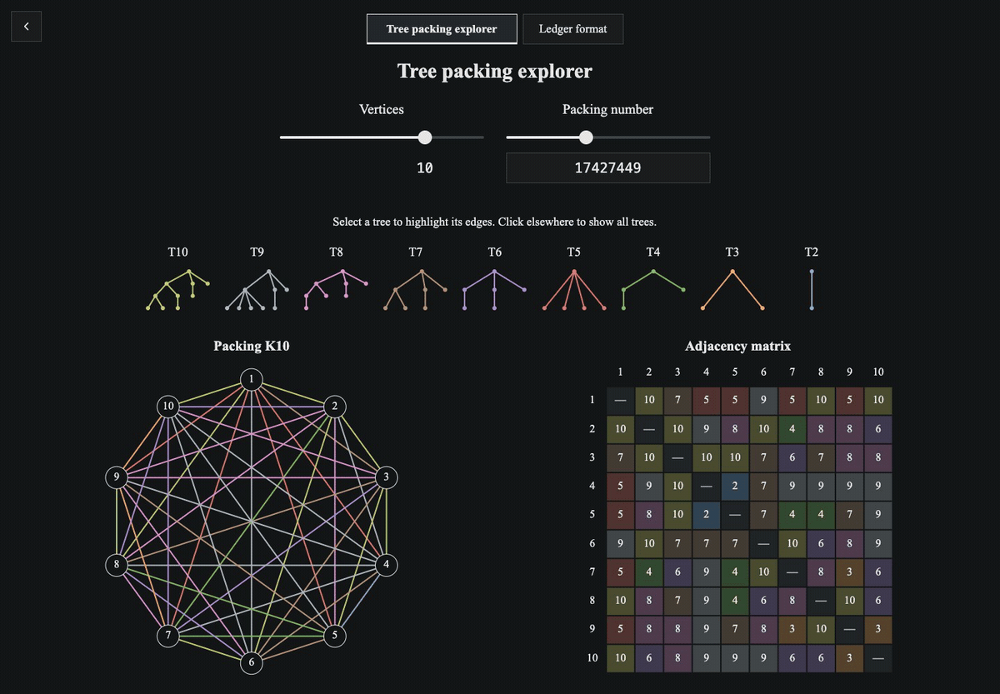

# Tree packing verification through n=13

<h2 align="center"><a href="https://alexyaroshe.com/tree-packing/#n=10&sequence=17427449&base=1"><strong>Tree packing explorer</strong></a></h2>

[](https://alexyaroshe.com/tree-packing/#n=10&sequence=17427449&base=1)

## Run locally

Requires Linux or macOS, Python 3.9+, C17/C++17 compilers, make and zstd. See [requirements](format.md#requirements).

Run these commands from the repository folder, in a path without spaces.

### Build

Build once before either workflow below. The `build` directory must not already exist.

```bash
python3 build.py --jobs 4
```

### Optional: run a small example

Search n=5, archive the certificate and run both checkers. This example is not required to verify a downloaded certificate.

```bash
python3 run.py start --n 5 --build build/campaign/bin \
  --trees trees.txt --output build/n5 --minimum-free-mib 1024 \
  --memory-mib 1024 --solver-seconds 60 --verify-seconds 60 --total-seconds 300
```

Success: `build/n5/finished.json` has top-level `status` set to `verified`, with both checker verdicts under `verdicts`.

### Verify a downloaded certificate

Download and extract `n11_placement_only.zip`. Replace `/path/to/n11_placement_only` below with the extracted folder's path.

```bash
python3 verify.py --package /path/to/n11_placement_only \
  --output build/verify-n11 --seconds 600
```

Success: `build/verify-n11/finished.json` has top-level `status` set to `verified`, with both checker verdicts under `stream.verdicts`.

For either workflow, the output directory must not already exist.

## Files

| File | Contents |
|---|---|
| [tree-packing-demo.gif](tree-packing-demo.gif) | Explorer demo |
| [build.py](build.py) | Build |
| [run.py](run.py) | Campaign |
| [verify.py](verify.py) | Certificate verification |
| [format.md](format.md) | Formats, scope & requirements |
| [certificates.json](certificates.json) | Certificate identities & source paths |
| [manifest.json](manifest.json) | Source & dependency hashes |
| [SHA256SUMS](SHA256SUMS) | Checksums |
| [CITATION.cff](CITATION.cff) | Citation |
| [LICENSE](LICENSE) | License |
| [.gitignore](.gitignore) | Build & cache exclusions |
| [tests/test_release.py](tests/test_release.py) | Release tests |
| [trees.txt](trees.txt) | Tree catalog |
| [reconstruction/graph_helpers.cpp](reconstruction/graph_helpers.cpp) | Graph & placement helpers |
| [checkers/check_proof.cpp](checkers/check_proof.cpp) | C++ checker |
| [checkers/check_proof_independent.c](checkers/check_proof_independent.c) | Second checker (independent) |
| [solver/solver.cpp](solver/solver.cpp) | Parallel solver |
| [solver/build.py](solver/build.py) | Campaign build |
| [solver/run_campaign.py](solver/run_campaign.py) | Checkpoints, restart & archive verification |
| [reconstruction/state_serial.cpp](reconstruction/state_serial.cpp) | Serial state reconstruction |
| [reconstruction/verify_serial.py](reconstruction/verify_serial.py) | Campaign archive verification |
| [reconstruction/state_parallel.cpp](reconstruction/state_parallel.cpp) | Parallel state reconstruction |
| [reconstruction/build_states.py](reconstruction/build_states.py) | State verification build |
| [reconstruction/verify_states.py](reconstruction/verify_states.py) | State archive verification |
| [reconstruction/placements.cpp](reconstruction/placements.cpp) | Placement reconstruction |
| [reconstruction/build_placements.py](reconstruction/build_placements.py) | Placement verification build |
| [reconstruction/verify_placements.py](reconstruction/verify_placements.py) | Placement archive verification |
| [dependencies/nauty2_9_3.tar.gz](dependencies/nauty2_9_3.tar.gz) | nauty source |
| [dependencies/COPYRIGHT](dependencies/COPYRIGHT) | nauty copyright |
| [dependencies/LICENSE-2.0.txt](dependencies/LICENSE-2.0.txt) | nauty license |
